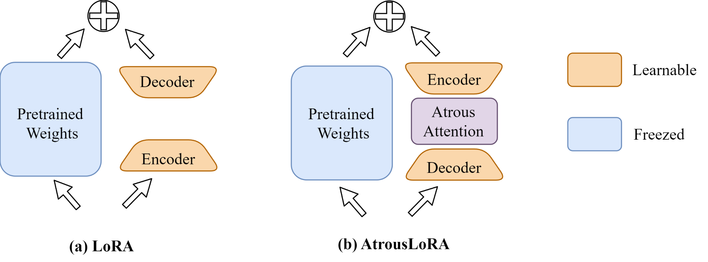
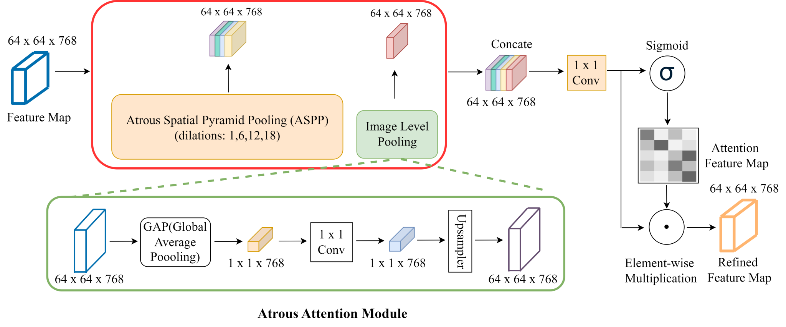

# VesselSAM

Aortic vessel segmentation in CT angiography with **SAM + AtrousLoRA**. Give it a CT slice and a bounding box to get a vessel mask.

<p align="center">
  
</p>

<details>
<summary>Atrous attention module</summary>
<p align="center">
  
</p>
</details>

## 🚀 Quick start

You’ll need Python 3.10+, Git, and [PyTorch + torchvision](https://pytorch.org/get-started/locally/) for your device.

```bash
git clone https://github.com/vikkki/VesselSAM.git
cd VesselSAM
python -m pip install -e ".[sam]"
```

**Weights — Hugging Face link coming soon.** Choose `AVT6.pt` (AVT) or `TBAD10.pt` (TBAD), plus the matching [MedSAM ViT-B base weights](https://github.com/bowang-lab/MedSAM). [Checkpoint details](checkpoints/README.md).

Point to your downloaded weights and image, then run:

```bash
python -m vesselsam predict \
  --checkpoint /path/to/AVT6.pt \
  --base-checkpoint /path/to/medsam_vit_b.pth \
  --image /path/to/slice.png \
  --box 120 80 340 410 \
  --output-dir outputs/prediction
```

Replace `--box` with your own `xmin ymin xmax ymax` in original-image pixels. CUDA is used when available; add `--device cpu` to run on CPU.

You’ll get `mask.png`, `probability.npy`, and `prediction.json`. Masks keep the input image size.

<details>
<summary>Preparing your CT slice</summary>

- Use 2D slices at **1 mm in-plane spacing** and a **400 HU width / 40 HU level** window.
- Inputs: 8-bit PNG/JPEG, or NPY/NPZ arrays in `[0,1]` (NPZ key: `image`).
- For NPY/NPZ arrays already in HU, add `--raw-hu` to apply the window.
- Supply one box per slice. Volume resampling and vessel localization are external steps.

</details>

## 📄 Paper

Zhao, X., Zhuang, P., Zhang, Z. *et al.* **VesselSAM: a parameter-efficient adaptation of SAM to aortic vessel segmentation with AtrousLoRA.** *BMC Medical Imaging* (2026). [Article / DOI](https://doi.org/10.1186/s12880-026-02911-1).

Built on [SAM](https://github.com/facebookresearch/segment-anything) and [MedSAM](https://github.com/bowang-lab/MedSAM). Code: [MIT](LICENSE). Upstream projects and weights retain their own licenses.
